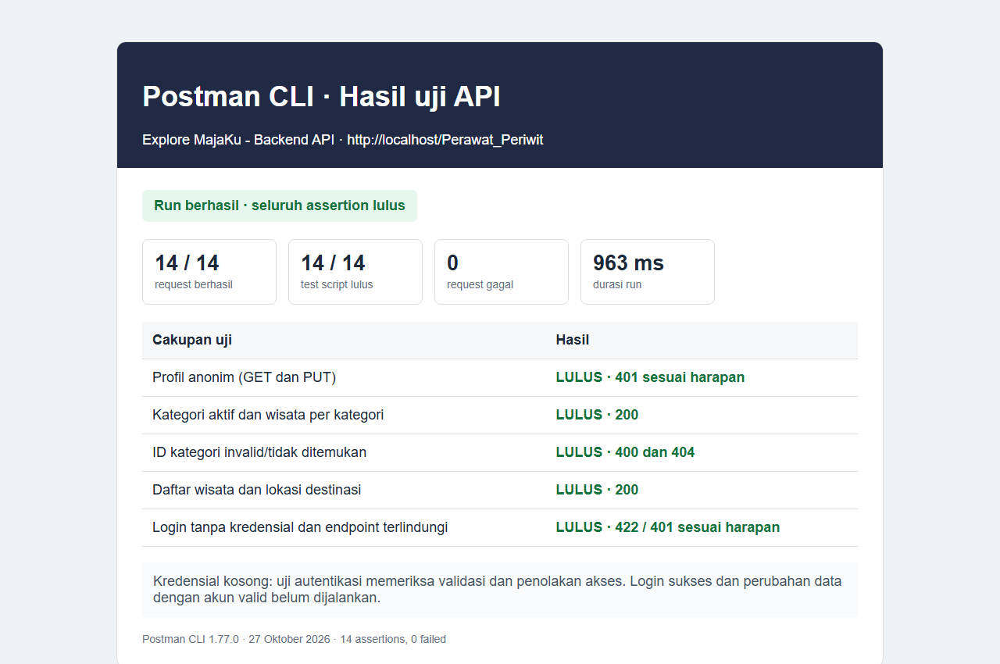

# Bukti Uji API dengan Postman

Tanggal uji: 27 Oktober 2026  
Alat: Postman CLI 1.77.0  
Koleksi: `Backend/api/postman/Explore MajaKu - Backend API`  
Base URL: `http://localhost/Perawat_Periwit`

## hasil run

koleksi mengirim 14 request : 14 tes script dan 14 lulus, tanpa request gagal. pengujian meliputi profil anonim, kategori, wisata, validasi id kategori, lokasi destinasi, login dengan kredensial kosong, dan penolakan endpoint terlindungi tanpa session.

[]
## script
postman collection run "Backend/api/postman/Explore MajaKu - Backend API" --reporters cli --no-report-events

## Script assertion Postman

Assertion di bawah menggunakan JavaScript Postman Sandbox (`pm.test`, `pm.response`). Skrip per request lengkap juga tersimpan pada file `.request.yaml` di folder koleksi tersebut.

**GET profil tanpa login — harapkan `401`:**
```javascript
pm.test('Anonymous GET returns 401', function () {
    pm.response.to.have.status(401);
    pm.expect(pm.response.json().status).to.eql('unauthenticated');
});
```
**GET kategori aktif — harapkan `200` dan struktur data valid:**
```javascript
pm.test('Active categories include ID, name, and image', function () {
    pm.response.to.have.status(200);
    const categories = pm.response.json().data;
    pm.expect(categories).to.be.an('array').that.is.not.empty;
    categories.forEach(function (category) {
        pm.expect(category.id_kategori).to.be.a('number');
        pm.expect(category.nama).to.be.a('string').and.not.empty;
        pm.expect(category).to.have.property('gambar');
    });
    pm.collectionVariables.set('categoryId', categories[0].id_kategori);
});
```

**GET kategori dengan ID tidak valid — harapkan `400`:**
```javascript
pm.test('Malformed category ID returns 400', function () {
    pm.response.to.have.status(400);
    pm.expect(pm.response.json().status).to.eql('invalid_category_id');
});
```

**Login tanpa kredensial — harapkan validasi `422`:**

```javascript
pm.test('Login validates missing credentials', function () {
    pm.response.to.have.status(422);
    pm.expect(pm.response.json().status).to.eql('validation_error');
});
```
